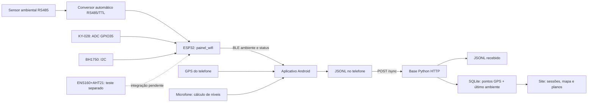
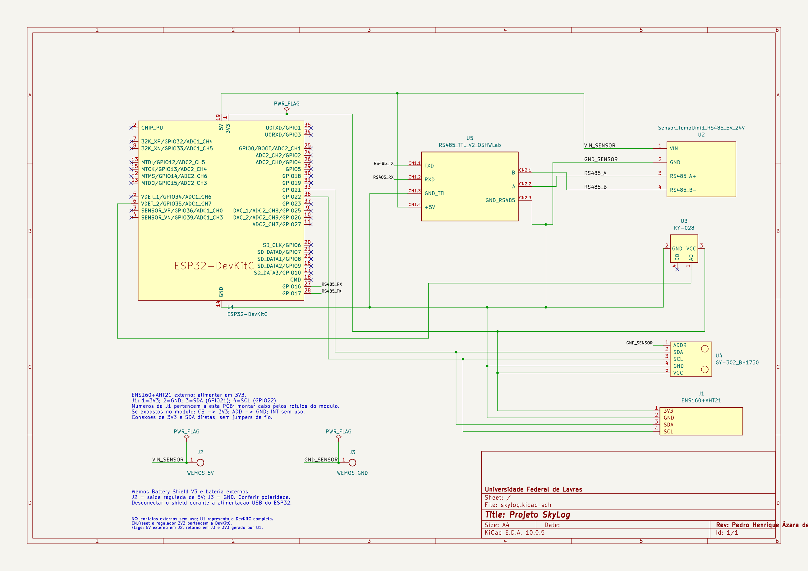
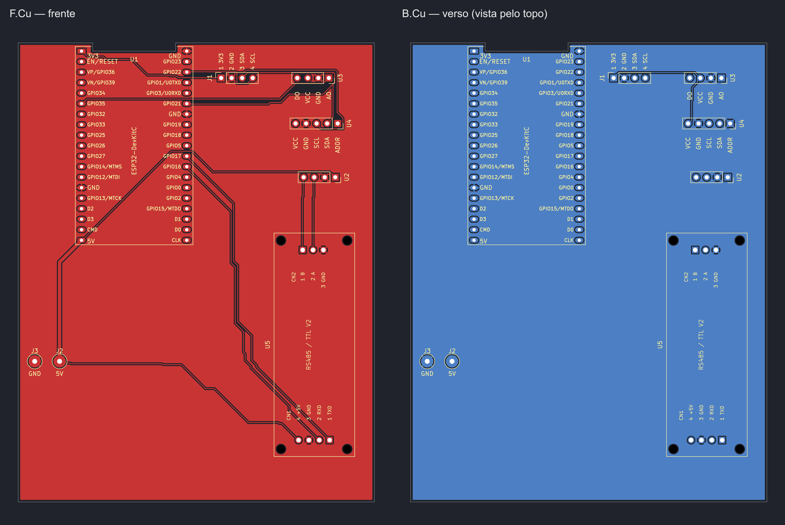
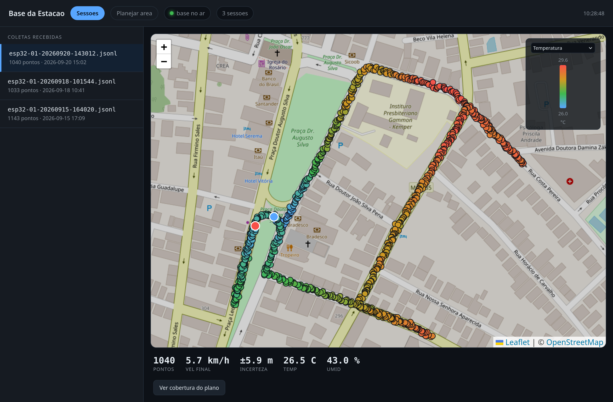

# Skylog — documentação técnica do estado local de 10/10/2026

> Captura anterior à reorganização e à limpeza solicitadas na mesma data.
> Testes executados e evidências abaixo pertencem à análise inicial. Arquivos
> legados foram removidos posteriormente; links de navegação foram ajustados.
> Consulte a [estrutura atual e as remoções](../../organizacao/2026-10-10/relatorio.md).
> As fontes KiCad e figuras copiadas nesta pasta preservam o estado da captura.

## 1. Identificação

| Campo | Identificação |
|---|---|
| Objetivo | Coletar medições ambientais em percursos, associá-las ao GPS do telefone e consultar sessões numa base web |
| Público | Pessoas responsáveis por montagem, coleta, desenvolvimento e manutenção |
| Estado | Protótipo em desenvolvimento; V1 é a configuração pretendida, ainda sem validação integrada do hardware definitivo |
| Data da análise | 10/10/2026, referência de fuso America/Sao_Paulo |
| Commit-base | `2cd59777b90f2dd33dc27cc1e1f5b2505c5105bb`, de 02/10/2026 |
| Árvore analisada | Estado local, com modificações anteriores em documentação, PCB/projeto `skylog.kicad-pedro_sch`, ferramenta `cnc-jog` e exportações não rastreadas |
| Aplicativo | `estacao_movel`, versão declarada `1.0.0+1`; interface Skylog, nome Android Estacao Movel |
| Firmware/base | Sem número de versão independente encontrado nas fontes consultadas |
| Hardware | Dois projetos no formato KiCad 10: principal `skylog` e variante `skylog.kicad-pedro_sch`; campo de revisão do esquema contém um nome, não um número de revisão |

Esta captura **não é uma versão publicada nem uma árvore idêntica ao commit**.
O [estado inicial do Git](evidencias/estado-inicial-git.txt) e os
[hashes SHA-256 das fontes](evidencias/fontes-sha256.json) identificam os arquivos
presentes antes desta revisão documental. As cópias em `fontes/` preservam os dois
esquemas, PCBs e configurações de projeto. As bibliotecas locais e modelos 3D
continuam na árvore de hardware; essas cópias documentais não constituem um pacote
independente de fabricação.

## 2. Visão geral

O fluxo implementado reúne BLE, gravação JSONL no Android, envio HTTP e
processamento SQLite na base. O telefone é responsável pelo GPS e pelo som;
para som são gravados níveis calculados, sem salvar áudio.

| Recurso | Situação constatada nas fontes |
|---|---|
| RS485 temperatura/umidade, KY-028, BH1750 | Aquisição e publicação no `painel_wifi`; seleção/recepção no aplicativo |
| ENS160+AHT21 | Interface no esquema e sketch de teste separado; falta integração no firmware principal, BLE, app e base |
| GPS do telefone | Captura, seleção, gravação e pontos de mapa implementados |
| Microfone do telefone | Prévia, calibração, gravação de níveis e preservação no JSONL implementadas; não incorporado ao mapa/derivado SQLite |
| KY-013 e KY-038 | Retirados da montagem pretendida, mas ainda adquiridos no firmware e selecionáveis na interface atual |
| WTGAHRS3 | Retirado da montagem pretendida; driver e consultas GPS/IMU ainda presentes no firmware |
| Base | HTTP e SQLite implementados, sem consumidor MQTT e sem aplicação de Kalman no processamento atual |
| Planos de coleta | Áreas, planos ativos e cruzamento espacial com pontos implementados em `planejamento.py` e nas interfaces |
| PCB, CNC e caixa | Arquivos de engenharia e ferramenta auxiliar presentes; montagem, usinagem e validação física final não verificadas nesta análise |

A recepção/gravação local não exige acesso à base. Isso não equivale a operação
completa do ESP32 sem Wi-Fi: quando o firmware entra no portal de configuração,
BLE permanece anunciado, mas o fluxo de aquisição/publicação não é executado.

## 3. Arquitetura e funcionamento

O diagrama abaixo representa o caminho atual. A linha tracejada identifica
integração planejada. Fonte editável: [arquitetura.mmd](figuras/arquitetura.mmd).



Figura 1 — arquitetura baseada no código lido em 10/10/2026, não evidência de
execução com sensores reais. O ENS160+AHT21 não participa do caminho integrado.

### Módulos de software

| Caminho na raiz | Responsabilidade |
|---|---|
| `firmware/painel_wifi/painel_wifi.ino` | Wi-Fi, portal, escalonamento de sensores, publicação BLE e MQTT legado |
| `firmware/painel_wifi/ambiente_rs485.*` | Modbus RTU, silêncio entre quadros, sincronismo de resposta e CRC |
| `firmware/painel_wifi/ble_estacao.*` | Serviço BLE e características de dados/configuração/localização |
| `app/lib/main.dart`, `telas/` | Navegação Início, Sensores, Mapa, Planos e Coletas |
| `app/lib/modelo/sensores.dart`, `coleta/central_sensores.dart` | Seleção persistida, prontidão, bloqueio durante sessão e coordenação do som |
| `app/lib/ble/estacao_ble.dart`, `contrato.dart` | Descoberta e conexão BLE, interpretação e encaminhamento de dados |
| `app/lib/gps/`, `audio/` e integração Android | Localização e medição sonora do telefone |
| `app/lib/armazenamento/gravador.dart` | Sessões JSONL, flush periódico e encerramento |
| `app/lib/rede/` | Sincronização HTTP, endereço da base e planos |
| `src/servidor_telemetria.py` | Recepção HTTP, página web embutida e consultas SQLite |
| `src/processar_sessao.py` | Conversão JSONL → linhas derivadas; não chama Kalman |
| `src/planejamento.py` | Persistência de planos e associação espacial às medições |
| `src/filtro_kalman.py`, `src/kalman/`, ferramentas WTG | Estudos e processamento legado; não integram o caminho atual da base |
| `cnc-jog/` | Aplicação separada de oficina; não coleta medições meteorológicas |

### Interfaces e dados

O serviço BLE é `e5710000-b100-4a1e-9d2f-7c3a5b8e1f40`. Os sufixos
`0001` a `0006` identificam `status`, `pos`, `amb`, `imu`, `cfg` e `loc`.
Os valores coincidem em `ble_estacao.h` e `contrato.dart`; o app solicita MTU
517 e busca pelo serviço. O nome padrão anunciado é `esp32-01`.

O payload ambiental existente usa `temp` (°C), `umid` (%RH), `t28` (°C), `lux`
(lx), além de `t13` e `db` dos módulos antigos. `lux = -1` indica falha de
leitura; zero lux é válido. A seleção do app filtra os campos a gravar.
Não existem campos de eCO₂/TVOC/AQI no payload principal.

Cada linha do JSONL tem `src`, `ts_app` e `m`. O primeiro registro da coleta
identifica a seleção; os demais podem incluir `amb`, `gps` e `som_celular`.
`ts_app` é produzido ao anexar o dado no telefone, sem offset explícito; não é
um horário de aquisição sincronizado no sensor. O arquivo fica no diretório
de documentos do app, em `sessoes/<dev>-AAAAMMDD-HHMMSS.jsonl`.
Há solicitação de flush a cada 2 s e no encerramento, sem comprovação de
durabilidade em desligamento abrupto do telefone.

Em `gps`, latitude/longitude usam graus decimais, `vel` usa km/h, `precisao`
usa metros e `rumo` usa graus.

Exemplo **sintético** de duas linhas de dados, com GPS e temperatura/umidade
selecionados (o envelope inicial de seleção foi omitido):

```json
{"src":"amb","ts_app":"2026-10-10T12:00:00","m":{"temp":23.5,"umid":55.0}}
{"src":"gps","ts_app":"2026-10-10T12:00:02","m":{"lat":-21.0,"lon":-44.0,"vel":1.4,"precisao":5.0}}
```

| Interface da base | Uso |
|---|---|
| `GET /` | Site de sessões e planejamento |
| `POST /sync` | Corpo `application/x-ndjson`; cabeçalhos `X-Dev` e `X-Sessao` |
| `GET /sessoes` | Lista com sessão, dispositivo, data de processamento e quantidade de pontos |
| `GET /sessao?nome=...` | Trajeto, medições por ponto e resumo |
| `GET /sessao/cobertura?nome=...` | Cobertura em relação ao plano ativo |
| `GET /planos?dev=...`, `/plano?id=...`, `/plano/ativo?dev=...`, `/plano/pontos?id=...` | Consulta de planos e medições nas áreas |
| `POST /plano`, `/plano/atualizar`, `/plano/apagar`, `/plano/ativar`, `/plano/desativar` | Operações de planejamento |

O servidor escuta em `0.0.0.0:8771` por padrão. Não há autenticação ou TLS no
código consultado; a implantação documentada é em rede local controlada.
Os mapas do site usam Leaflet 1.9.4 via CDN e tiles OpenStreetMap: visualizar
mapas completos não foi demonstrado offline.

A base salva `data/sincronizadas/<dev>/<sessao>.jsonl`. Reenvio igual ou menor
em bytes mantém a cópia anterior; reenvio maior a substitui por renomeação de
arquivo temporário e reprocessa. Portanto, “cru imutável” é uma intenção de
custódia, não uma garantia de preservação de todas as revisões recebidas.
A comparação é por tamanho, não por hash ou conteúdo.

`data/estacao.db` contém as tabelas `sessoes`, `derivado` e as de planejamento.
Cada registro GPS válido gera um ponto com o último ambiente conhecido;
`kf_lat`/`kf_lon` repetem o GPS bruto. Não há expiração do ambiente por idade
nesse processamento. Sem GPS, a sessão pode ser recebida com zero pontos.
`som_celular` é preservado no JSONL, mas ignorado na derivação atual.

## 4. Requisitos e materiais

### Ferramentas

| Item | Requisito/versão constatada |
|---|---|
| Python | Testes e base verificados com Python 3.13.2; mínimo do projeto não declarado |
| Base HTTP/SQLite | Usa biblioteca padrão; não exige Mosquitto ou pacotes de `requirements.txt` para iniciar |
| Ferramentas Python auxiliares | Manifesto pede pyserial ≥3.5, minimalmodbus ≥2.1.1, matplotlib ≥3.5 e paho-mqtt ≥2.1.0; não são versões travadas |
| Flutter/Dart | Flutter 3.47.1 e Dart 3.13.1 disponíveis nesta máquina; `pubspec.yaml` pede Dart `^3.13.1` |
| Dependências Android | `flutter_blue_plus`, `geolocator`, `path_provider`, `intl`, `flutter_map`, `latlong2`; resoluções em `app/pubspec.lock` |
| ESP32 Arduino | Core 3.3.11 encontrado localmente; PubSubClient 2.8 instalado; compilação não executada nesta revisão |
| Teste ENS160+AHT21 | Solicita SparkFun ENS160 e Adafruit AHTX0, com dependências Adafruit; versões não fixadas |
| KiCad | Fontes no formato 10.0; CLI local 9.0.9 falhou na leitura do esquema |

### Lista de materiais da montagem pretendida

Quantidades por estação; especificações não comprovadas fisicamente permanecem
pendentes. As referências são da placa principal, não dos chips internos dos módulos.

| Referência | Qtd. | Item | Observações |
|---|---:|---|---|
| U1 | 1 | ESP32 DevKit de 38 contatos | Principal usa footprint DevKitC BoardEdge; variante usa NodeMCU 38Pin 4Furos AConferir; conferir a placa real |
| U2 | 1 | Sensor ambiental RS485 | Temperatura/umidade; símbolo rotulado 5V–24V; alimentação prevista na PCB é 5 V, ainda depende de confirmação do exemplar |
| U3 | 1 | KY-028 | Externo por cabo; AO em GPIO35, DO sem uso |
| U4 | 1 | GY-302/BH1750 | Externo; I²C, ADDR em GND |
| U5 | 1 | Conversor RS485/TTL V2 automático | Entrada 5 V; direção automática; identidade do transceptor e encaixe físico pendentes |
| J1 | 1 | Interface 1×4, passo 2,54 mm | Conexão ao módulo ENS160+AHT21 externo |
| Sem referência própria | 1 | Módulo ENS160+AHT21 | Interface em 3,3 V conforme projeto; conferir se a placa adquirida aceita essa alimentação |
| J2/J3 | 1 par | Pads de alimentação 5 V/GND | Pads de 3 mm e furos 1,2 mm na proposta principal |
| Externo | 1 | Wemos Battery Shield V3 | Saída regulada 5 V prevista; capacidade sob carga não medida nesta revisão |
| Externo | A definir | Bateria, cabos, terminais e fixadores | Modelo/capacidade da bateria e especificação final dos cabos ausentes |
| Base | 1 | Computador Linux ou Raspberry Pi | Pi 3B V1.2 citado no guia anterior; equipamento não acessado nesta revisão |
| Campo | 1 | Telefone Android | BLE, localização e microfone; permissões necessárias conforme uso |

Não se acrescentam KY-013, KY-038 ou WTGAHRS3 à lista da V1 só porque seus drivers
continuam presentes. Pressão atmosférica não tem aquisição integrada disponível.

## 5. Montagem e instalação

### Esquemas e variantes

- Principal: [esquema editável capturado](fontes/skylog.kicad_sch),
  [PCB capturada](fontes/skylog.kicad_pcb), [projeto](fontes/skylog.kicad_pro).
- Variante local: [esquema capturado](fontes/skylog.kicad-pedro_sch.kicad_sch),
  [PCB capturada](fontes/skylog.kicad-pedro_sch.kicad_pcb),
  [projeto](fontes/skylog.kicad-pedro_sch.kicad_pro).



Figura 2 — exportação existente da proposta principal, oriunda de
`hardware/skylog/documentacao/proposta-final/esquema.png`, associada aos relatórios
de 02/10/2026. [SVG original preservado](figuras/esquema-principal-2026-10-02.svg).
O cartucho original tem texto de revisão que ultrapassa a margem; referências e
conexões do circuito estão legíveis. Não é uma nova exportação, foto ou validação
da variante local. O original editável foi preservado acima.



Figura 3 — visualização existente da proposta bicamada, com verso visto pelo
topo, oriunda de `documentacao/proposta-final/pcb.png`. Fontes vetoriais:
[frente](figuras/pcb-frente-2026-10-02.svg) e [verso](figuras/pcb-verso-2026-10-02.svg).
É desenho de engenharia, não fotografia da placa fabricada.

A PCB principal tem contorno de 86 × 111 mm, recorte superior de 20 × 2 mm e
135 segmentos F.Cu/15 B.Cu. A variante local tem contorno de 100 × 100 mm com
cantos arredondados, 75 segmentos B.Cu e nenhum F.Cu, mais H2–H5 para fixação.
Não é correto transferir automaticamente as instruções de usinagem bicamada
para ela. Essas contagens foram extraídas do arquivo, sem executar DRC.

### Tabela de conexões

Conferida contra as redes dos pads nas duas PCBs e os nomes/pinos dos símbolos
consultados. Os números pertencem aos símbolos/footprints, não garantem a ordem
física do módulo comprado. A conferência de redes não comprova continuidade das
trilhas fabricadas nem paridade completa entre esquema e PCB.

| Origem | Destino | Sinal/observação |
|---|---|---|
| J2.1 | U1.19, U2.1, U5.CN1.4 | 5 V regulados; rede `/VIN_SENSOR` na principal e `+5V` na variante |
| J3.1 | U1.14/32/38, U2.2, U3.2, U4.1/4, U5.CN1.3/CN2.3, J1.2 | GND comum; U4.1 fixa ADDR baixo |
| U1.1 | U3.3, U4.5, J1.1 | 3V3 |
| U1.28 (GPIO17/TX2) | U5.CN1.1 (TXD entrada) | UART para conversor |
| U5.CN1.2 (RXD saída) | U1.27 (GPIO16/RX2) | UART para ESP32 |
| U5.CN2.2 | U2.3 | RS485 A |
| U5.CN2.1 | U2.4 | RS485 B |
| U1.33 (GPIO21) | U4.2, J1.3 | SDA compartilhado |
| U1.36 (GPIO22) | U4.3, J1.4 | SCL compartilhado |
| U3.1 (AO) | U1.6 (GPIO35) | Entrada analógica KY-028 |
| U3.4 (DO) | Sem conexão funcional | Não utilizado |

No cabo de J1: 1=3V3, 2=GND, 3=SDA, 4=SCL. Se o módulo ENS160 expuser CS e ADD,
o projeto prevê CS em 3V3, ADD em GND, INT sem uso; conferir os rótulos do módulo.
Não aplicar tensão de bateria bruta, 12 V ou 24 V a J2. A rede da placa une a
alimentação do sensor à entrada de 5 V do ESP32: uma fonte de sensor diferente
exige revisão elétrica, não apenas troca de tensão na entrada.

O conversor documentado não expõe DE/RE. O driver aceita `PINO_DE = -1`, mas
`painel_wifi` ainda define `4`. A divergência está registrada, sem alteração do
firmware nesta entrega. A [documentação do conversor](../../../hardware/skylog/documentacao/conversor-rs485.md)
registra conflito entre identificações de transceptor e limitações do footprint;
conferir o exemplar real antes de decidir montagem direta ou cabos.

### Sequência de preparação física — proposta, não executada

1. Escolher explicitamente a variante da PCB, conferir DevKit, conectores,
   encaixes e orientação dos cabos reais; reabrir no KiCad compatível.
2. Executar ERC, DRC e comparação esquema/PCB dessa variante; conferir contorno,
   folgas, alimentação e ferramentas de usinagem. Gerbers existentes não bastam.
3. Gerar e inspecionar os percursos adequados à variante. Na bicamada, definir
   alinhamento entre faces e interligação de furos sem metalização.
4. Após fabricação, conferir continuidade e isolamento antes da montagem;
   medir 5 V/3V3 e polaridade. Não combinar alimentação USB e shield sem resolver
   o caminho de alimentação previsto no projeto.
5. Montar por etapas: alimentação, ESP32, conversor e sensores; validar cada
   interface com os testes específicos. Dimensionar a caixa após a montagem real.

Não há fotografia confirmada do conjunto montado nessa revisão. Faltam vista
superior com conectores identificados, verso com soldas e foto da alimentação.
Fotos de módulos de terceiros em `modelos/` não foram usadas como prova do protótipo.

### Instalação de software

**Base:** na raiz do repositório, com Python e SQLite disponíveis:

```bash
python3 src/servidor_telemetria.py --porta 8771
```

Abrir `http://localhost:8771`; no telefone, informar o nome/IP dessa máquina.
Não é necessário instalar broker para esse caminho. `requirements.txt` atende
ferramentas auxiliares/legadas. Para serviço permanente, adaptar usuário e caminhos
em `servidor/telemetria.service`; o exemplo usa `/home/pedro/estacao` e não é
portável sem ajuste. Nenhum serviço foi instalado ou reiniciado nesta revisão.

**Aplicativo:** abrir `app/` no Android Studio ou usar o SDK Flutter compatível.
Para uma nova máquina, resolver dependências e executar no aparelho:

```bash
cd app
flutter pub get
flutter run -t lib/main.dart
```

Esses comandos são instruções; não houve instalação de dependências nem execução
em telefone nesta revisão. Os testes foram executados com dependências já locais,
sem `pub get`. Detalhes de USB, SDK e APK: [README do app](../../../app/README.md).

**Firmware:** abrir `firmware/painel_wifi/painel_wifi.ino` na Arduino IDE com core
ESP32 e PubSubClient; selecionar ESP32 Dev Module e partição Huge APP
(3 MB, sem OTA); monitor serial 115200 baud. Com `arduino-cli` disponível, a
instrução existente de compilação é:

```bash
arduino-cli compile --fqbn esp32:esp32:esp32:PartitionScheme=huge_app firmware/painel_wifi
```

Compilação e gravação não foram executadas. Versões/tamanhos de binário citados no
[README do firmware](../../../firmware/README.md) são registros anteriores.
Resolver as divergências de integração antes de tratar esse sketch como firmware
final da V1. O teste ENS160+AHT21 é um programa separado, que substitui o programa
anterior ao ser gravado; não acrescenta funções ao `painel_wifi` automaticamente.

## 6. Uso e operação

1. Conferir montagem e firmware adequados. No código atual, configurar uma rede
   Wi-Fi acessível para sair do portal e iniciar a aquisição ambiental; base HTTP
   e rede Wi-Fi são dependências distintas.
2. Abrir Skylog no Android, permitir localização/Bluetooth conforme solicitado e
   conferir a conexão `esp32-01`. A descoberta é automática por UUID.
3. Em **Sensores**, escolher GPS, som e sensores realmente disponíveis. Deixar
   KY-013/KY-038 desmarcados na montagem pretendida; ENS160 ainda não é opção.
4. Para som, usar **Testar microfone**. Conferir prontidão: GPS até 5 s, som até
   2 s, ambiente até o maior entre 5 s e três intervalos de publicação. A prontidão
   atesta recepção de valores, não calibração física.
5. Iniciar coleta; a seleção fica bloqueada. Manter o app em primeiro plano
   quando houver som: interrupção do microfone encerra a sessão e preserva os
   registros recebidos. Encerrar antes de parar/reiniciar o app.
6. Em **Coletas**, informar somente host/IP da base, sem protocolo nem porta;
   o app usa 8771. Enviar e preservar a cópia do telefone. A marca `.enviado`
   indica sucesso reportado pelo app, mas não garante processamento sem erro.
7. Abrir o site, escolher sessão/medida ou planejar uma área. Sessões sem GPS não
   geram pontos. A medida de ruído atual corresponde a `amb.db`, não ao microfone
   do telefone. Verificar `erro_processamento` em caso de ausência de pontos.

Sem calibração, som é apresentado em dBFS. O app permite ajuste por referência
para dB SPL estimado; isso não estabelece precisão física ou certificação. A
captura nativa usa PCM16 mono, prefere 48 kHz, admite 44,1 kHz e calcula energia
removendo DC por bloco. Há testes de cálculo, calibração e estados da captura;
validação acústica real segue pendente.



Figura 4 — captura encontrada em `blog/img/painel-base-sessoes.png`, inspecionada
visualmente. Data de captura/autoria não confirmadas; mostra sessões de setembro,
não execução realizada nesta revisão nem a montagem V1 completa.

## 7. Verificação e testes

### Executados nesta revisão

| Procedimento | Resultado observado | Evidência/limite |
|---|---|---|
| `python3 -m unittest discover -s tests -v` | 7 testes passaram | [Log](evidencias/testes-python.txt); validam o filtro legado, não sensores nem fluxo físico |
| Em `app/`: `flutter test --no-pub --reporter expanded` | 66 testes passaram | [Log](evidencias/testes-flutter.txt); testes automatizados, sem telefone real |
| Em `app/`: `flutter analyze --no-pub` | Uma ocorrência informativa `curly_braces_in_flow_control_structures`, `lib/telas/tela_plano_mapa.dart:58:15` | [Log](evidencias/analise-flutter.txt); não foi apresentado como análise sem ocorrências |
| Envio HTTP para servidor temporário em loopback, com três registros sintéticos | Recepção e reenvio sem duplicação; 1 ponto, ambiente preservado, GPS bruto igual a `kf`; `som_celular` somente no bruto | [Log](evidencias/teste-base-http.txt); arquivos/banco temporários, sem tocar dados reais |
| Inspeção dos arquivos KiCad | Componentes, redes dos pads, contorno e quantidade de segmentos lidos | [Extração](evidencias/inspecao-hardware.json); não é ERC/DRC ou teste elétrico |
| Exportação do esquema com `kicad-cli sch export svg` | Falhou ao ler o esquema de formato 10 com CLI 9.0.9 | Nenhuma nova exportação/ERC/DRC foi obtida; imagens existentes preservadas |
| Revisão documental | Links locais, imagens, UUIDs, comandos e hashes conferidos | [Cobertura](cobertura-readmes.md); veja também [verificações](evidencias/verificacao-documental.txt) |

Ambiente: Linux nesta estação de trabalho, Python 3.13.2, Flutter 3.47.1, Dart
3.13.1. Não foram conectados sensores, gravado firmware, operada CNC nem acessada
a base real. Os testes existentes não provam integração física de ponta a ponta.

### Evidências anteriores preservadas

[ERC](evidencias/erc-historico-2026-10-02.json) e
[DRC](evidencias/drc-historico-2026-10-02.json) registram zero ocorrências para a
proposta principal em KiCad 10.0.5, em 02/10/2026. Contêm listas `ignored_checks`;
a afirmação de “nenhuma verificação desativada” não pode ser repetida como fato.
Não se aplicam automaticamente à variante local alterada.

As leituras de 23,0 °C/55,7 %RH e a varredura do sensor ambiental em 14/08/2026
estão relatadas no README do firmware; são evidências históricas textuais, não
medições repetidas nesta revisão. O driver atual usa endereço 1, 9600 8N1,
função 0x03, registros 0/1 divididos por 10, temperatura com sinal, e silêncio
entre quadros de 5 ms.

### Testes propostos, ainda não executados aqui

| Teste | Resultado esperado |
|---|---|
| Alimentação e continuidade da PCB escolhida | Polaridade correta, 5 V/3V3 nos pontos previstos, ausência de curtos |
| RS485 no conversor real | Respostas com CRC válido, temperatura/umidade coerentes e configuração de direção correta |
| I²C compartilhado | BH1750 em 0x23, AHT21 em 0x38 e ENS160 em 0x52/0x53; sem conflito de endereço |
| ENS160 integrado | Validade/estado e grandezas transmitidos, selecionáveis, gravados, processados e exibidos |
| Arranque sem Wi-Fi disponível | Após correção, aquisição e BLE ativos sem dependência da base/rede |
| Coleta de campo completa | GPS e sensores selecionados recentes, registros coerentes, sincronização e exibição conferidas |
| Queda de energia/rede e retomada | Quantificar perdas e verificar recuperação dos arquivos e processamento |
| Calibração do som e sensores | Comparar com referências físicas; registrar ambiente, incerteza e coeficientes |

## 8. Manutenção e solução de problemas

| Sintoma | Evidência ou hipótese | Diagnóstico/ação |
|---|---|---|
| BLE conecta, mas ambiente não atualiza após ligar sem rede | `modoConfig` retorna antes de adquirir/publicar; UART inicia só em `iniciarPainel()` | Conferir portal/rede; correção do firmware pendente |
| ENS160 não aparece no app | Não existe ID/payload integrado | Usar o teste específico para bancada; integrar firmware/app/base antes de coleta |
| Sensor ausente impede início da sessão | Prontidão exige leitura recente de todos os selecionados | Revisar seleção e conectividade; não substituir ausência por zero |
| Ruído do telefone não aparece no mapa | Derivação processa `amb`/`gps`, não `som_celular` | Conferir JSONL; integração sonora da base pendente |
| Arquivo recebido, zero pontos | Sessão sem GPS ou registros inválidos/sem horário | Conferir origens e campos; zero pontos não significa necessariamente perda do arquivo |
| App informa “enviada”, mas dados não aparecem | App não verifica `erro_processamento` do retorno | Consultar resposta/log da base; não apagar cópia original |
| Dispositivo aparece como `esp32` | App e processador separam o nome pelo primeiro hífen | Identificação `esp32-01` é truncada; corrigir contrato antes de depender de múltiplas estações |
| Reprocessamento manual falha | `main()` em `processar_sessao.py` usa `sys` sem importá-lo | CLI direta tem defeito; função importada funciona, como verificado no ensaio HTTP |
| Sensor RS485 sem resposta | Possíveis alimentação, A/B, endereço ou conversor incorretos | Conferir módulo real e mapa do ambiental; não aplicar mapa WTG a ele |
| Lux inválido | BH1750 pode retornar sentinela -1; inicialização não repetida automaticamente no código lido | Conferir alimentação/I²C e reiniciar após correção; zero lux continua válido |

Preservar tanto JSONL quanto banco SQLite e registrar a versão usada para
processar. Alterar calibração, sensores ou variante de PCB exige atualizar os
contratos e repetir testes pertinentes. Não foi alterado código para corrigir
os defeitos encontrados, pois esta entrega é documental.

## 9. Pendências e limitações

1. Integrar ENS160+AHT21 de ponta a ponta e alinhar firmware/seleção à montagem V1.
2. Resolver a aquisição no portal Wi-Fi, `PINO_DE` e dependências das rotinas WTG.
3. Incorporar níveis do telefone no processamento/site, distinguindo dBFS de dB
   SPL estimado e de `amb.db` antigo.
4. Corrigir identificação de dispositivo com hífen, comando de reprocessamento
   e tratamento de `erro_processamento` na confirmação de envio.
5. Formalizar a política de atualização do JSONL recebido, idade do ambiente
   associado ao GPS e interpretação de horários sem fuso explícito.
6. Escolher/liberar a variante física, verificar compatibilidade DevKit/NodeMCU,
   conversor, tensão do sensor, bateria, conectores e footprint de montagem.
7. Gerar novos ERC/DRC, esquema e imagens da variante local com KiCad compatível.
   O ZIP de consolidação citado no README antigo não foi encontrado; não se
   presume que contenha os arquivos auxiliares ausentes.
8. Usinar, montar, validar alimentação/interfaces, medir autonomia/alcance e
   projetar caixa. Não há evidência atual de uma placa final montada.
9. Obter fotos reais com vista superior, verso e identificação de conectores;
   atualizar captura do app/site após integração final.

Melhorias posteriores, separadas do implementado: autenticação/implantação fora
da rede controlada, mapas offline, política de cópia de segurança e recuperação,
telemetria de diagnóstico e especificação de precisão das medições.

## 10. Referências e histórico

As afirmações sobre implementação derivam dos arquivos locais abaixo. Links
apontam à árvore de trabalho; os hashes de entrada identificam o estado analisado.
As imagens e fontes KiCad usadas nesta versão foram copiadas para esta pasta.

- [README principal](../../../README.md), [firmware](../../../firmware/README.md),
  [app](../../../app/README.md) e [hardware](../../../hardware/skylog/README.md).
- [Firmware principal](../../../firmware/painel_wifi/painel_wifi.ino),
  [driver ambiental](../../../firmware/painel_wifi/ambiente_rs485.h),
  [contrato BLE](../../../firmware/painel_wifi/ble_estacao.h) e
  [teste ENS160+AHT21](../../../firmware/teste_ens160_aht21/teste_ens160_aht21.ino).
- [Seleção](../../../app/lib/modelo/sensores.dart),
  [coordenação da coleta](../../../app/lib/coleta/central_sensores.dart),
  [gravação](../../../app/lib/armazenamento/gravador.dart),
  [sincronização](../../../app/lib/rede/sincronizador.dart) e
  [UUIDs do app](../../../app/lib/ble/contrato.dart).
- [Base HTTP](../../../src/servidor_telemetria.py),
  [processamento](../../../src/processar_sessao.py),
  [planejamento](../../../src/planejamento.py),
  [resultado do teste legado, removido após a análise](evidencias/testes-python.txt),
  [testes do aplicativo](../../../app/test/).
- [Requisitos Python](../../../requirements.txt),
  [manifesto do app](../../../app/pubspec.yaml),
  [lock do app](../../../app/pubspec.lock),
  [serviço da base](../../../servidor/telemetria.service).
- [Telemetria](../../04-telemetria.md), [implantação da base](../../05-base-raspberry-pi.md),
  [ERC histórico preservado](evidencias/erc-historico-2026-10-02.json)
  e [conversor](../../../hardware/skylog/documentacao/conversor-rs485.md).
- [Ferramenta de oficina](../../../ferramentas/cnc-jog/LEIA-ME.txt),
  [servidor de oficina](../../../ferramentas/cnc-jog/server.py) e
  [simulador](../../../ferramentas/cnc-jog/simulator.py), consultados para classificar o componente.

Nesta revisão foram criados o consolidado versionado e o inventário, atualizados
os quatro READMEs principais e a nota histórica de ERC e corrigidas referências relacionadas à arquitetura,
base e conversor. Foram preservadas as alterações locais anteriores e as notas
históricas; não foram alterados firmware, app, servidor, PCB ou arquivos de fabricação.
